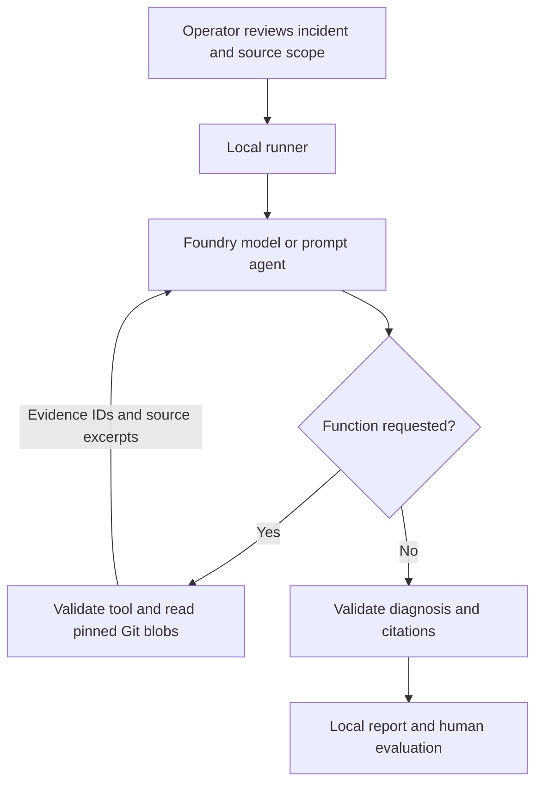

# Architecture and evidence boundaries

The CLI owns repository access and review. Foundry owns reasoning. Agent-mode function
requests are suggestions: local dispatch enforces the allowlist. Context-pack mode instead
retrieves everything deterministically before one model call.

For Azure DevOps build investigations, a separate read-only capture command retrieves one
build record, its timeline, a named failed log, a named provenance log, and explicitly
allowlisted files at the resolved commits. The model never receives Azure DevOps credentials
or calls Azure DevOps tools. The resulting local artifact is previewed and fingerprinted
before context-pack mode sends it to Foundry.

## Evidence provenance

Captured incident evidence carries IDs and source labels. The synthetic fixtures explicitly
identify themselves. Real exports should include timestamps, workload/container identity,
image digest, deployed source commit, and actual configuration. Never relabel synthetic
or candidate source as verified live evidence.

Repository retrieval supplies repository ID, commit, path and line range. Local-clone mode
requires the operator to establish the revision mapping. Azure DevOps capture resolves the
application revision from `Build.SourceVersion` and additional repository revisions only
from configured, unambiguous provenance-log labels.
Files are read using Git object IDs, not working-tree paths or model-supplied shell text.
Git fetching and authentication remain outside model execution. Existing clones can be
updated manually, then a specific commit selected for each investigation.

Azure DevOps capture uses a PAT only when `AZURE_DEVOPS_EXT_PAT` is explicitly present;
otherwise it uses the current Azure CLI identity. Authentication headers are never stored
in the capture. Failed-log evidence is selected locally from explainable error anchors and
bounded windows. Recognized credentials are replaced with typed placeholders in both logs
and repository excerpts before the capture is written. Secret-bearing file types are rejected.
The capture stores selection and redaction counts, never matched secret values.

## Deterministic context discovery

An optional `discovery` block in the capture policy replaces per-file allowlists. After the
application and shared-library commits are resolved (from `Build.SourceVersion` and the
provenance log; an unresolved commit fails the capture), the collector lists files only in
policy repositories at those exact commits, never a branch. It starts at `entry_pipeline`,
parses `resources.repositories` aliases and `template: path@alias` references (relative paths
resolve against the referencing file), and walks breadth-first with a visited set (cycles are
counted and skipped) bounded by depth and files inspected. Aliases that do not map to a policy
repository are reported, never fetched.

Anchors come from the sanitized failed-log selection and the pipeline files: source file and
line references, class and test names, Maven/Gradle goals, template paths, and property or
parameter names. Candidates score by fixed weights (pipeline entry 100, template 90, source
location 80, class 75, test counterpart 70, build file 40); ties break by role then path.
Only top-ranked files are fetched and excerpted (windows around referenced lines when a file
exceeds `max_excerpt_chars`). Explicit `allowed_files` remain an optional override, are always
included first and are not duplicated.

Every excerpt passes the existing path rejection, Secret-manifest rejection and redaction;
rejected files are counted as omitted by policy, never echoed. Each excerpt records role,
repository, commit, path, line range and reason in its evidence source and in
`context_selection`, which also reports repositories/files considered, files and excerpts
selected, characters, reason counts, omissions by policy and budget, unresolved anchors and the
bounds used. Preview prints the summary and exact excerpts; both are in the approval
fingerprint. Preview and run re-check that captured text is unchanged by sanitization.
Capture and preview make no model request; analysis stays one call with zero tools.

## Foundry adapter

Uses AzureCliCredential, AIProjectClient, prompt agent versions and the project Responses
client. Baseline bypasses the agent and has no tools. Both use the same model deployment,
incident evidence and diagnosis instructions. Each run has a fresh conversation.

The adapter targets the current project API, not classic hub connection-string APIs.
SDK/API availability and model support must be smoke-tested in the target project.
No API keys or corporate identifiers are embedded in the source.

Reference used for implementation:
https://learn.microsoft.com/en-us/azure/foundry/agents/how-to/tools/function-calling

## Privacy

Preview is entirely local. Explicit approval authorizes the exact incident and the complete
allowed file set for possible retrieval, destination and model. Only requested excerpts
are returned through tools. Repo content and logs may contain sensitive data. Deterministic
credential redaction reduces risk but cannot guarantee removal of every secret, PII, PHI or
proprietary value. Model output can quote submitted content, so the exact sanitized pack still
requires human review.

Do not enable SDK HTTP/body or content tracing for sensitive trials without reviewing the
destination and retention policy. Cloud conversations are cleaned up on normal exits;
interrupts, network failures or process death can leave resources. Project monitoring
and billing records have their own retention. .gitignore is not a data-loss-prevention system.

## Pipeline orchestration (reusable template)

`templates/azure-devops/investigate-failed-build.yml` adds no new engine. A consuming
repository supplies a thin wrapper, a pinned framework repository reference, its own capture
policy, a Foundry variable group and an Azure service connection; the template holds no
service-specific values. The framework is checked out explicitly and installed from that
checkout only.

Stage 1 runs `investigate-ado capture` and `investigate preview` and publishes the capture,
preview, fingerprint and a SHA-256 manifest as a run-scoped artifact; a `ManualValidation`
gate, linked to that run's artifacts, approves the bounded sanitized pack; stage 3 downloads
the same artifact, recomputes the preview fingerprint, and only on an exact match runs
`investigate run` under the service connection. Evaluation runs offline and only when the
consumer supplies a case. `System.AccessToken` is confined to capture and the service
connection to Analyze. See `examples/azure-devops/investigation-workflow/README.md`.

## Future OpsCart adapter

Add an authenticated API accepting the common Incident contract plus an operator-approved
workload mapping. OpsCart can supply captured evidence without changing the engine.
Do not expose arbitrary repository paths, cluster selectors or credentials through that API.
The standalone CLI remains usable. No OpsCart files are changed by this repository.

## Future indexed retrieval

Extract a retriever protocol once a second implementation is justified. Both direct and
indexed retrieval must return the same Evidence objects. Index only approved files and
retain commit/path/line provenance. Apply workload, revision and access filters before
retrieval. Do not index evaluation answers or real incident logs by default.

Azure AI Search is a candidate, not a prerequisite:
https://learn.microsoft.com/en-us/azure/foundry/agents/how-to/tools/ai-search
